<div align="center">



<a href="https://git.io/typing-svg">
  
</a>

<br/>


<a href="https://www.linkedin.com/in/jaint-kumar-khajumal-7a53622a0"></a>
<a href="mailto:jaintkumaroo@gmail.com"></a>

</div>

---

## 👨‍💻 About Me

```python
class JaintKumar:
    def __init__(self):
        self.role       = "Computer Systems Engineering Student @ MUET, Jamshoro"
        self.location   = "Hyderabad, Sindh, Pakistan 🇵🇰"
        self.focus      = ["Full-Stack Web", "Flutter Mobile Apps", "AI / Machine Learning", "Graphic Design"]
        self.currently  = "Building real-world products and polishing my final-year skills"
        self.learning   = ["Advanced Flutter", "ML model deployment", "Prompt engineering"]
        self.open_to    = ["Internships", "Junior roles", "Freelance projects", "Team collaborations"]

    def motto(self):
        return "Keep learning. Ship real things. Make them look good."
```

---

## 🛠️ Tech Stack

**Languages**


**Frameworks and Libraries**


**Databases and Cloud**


**Design and Tools**


---

## 🚀 Featured Projects

| Project | What it does | Tech |
|---|---|---|
| 🛍️ **ShopHub** | Full-stack e-commerce platform for sales and rentals, with role-based admin login, inventory dashboard, and CRUD for products and orders. Team of 3. | `PHP` `MySQL` `JavaScript` `Bootstrap` |
| 🛡️ **AI-Powered DNS Security Analyzer** | Real-time DNS threat detection that flags domains as NORMAL or SUSPICIOUS with confidence scores. Over 85% accuracy and under 5% false positives, with a live Tkinter dashboard. | `Python` `Tkinter` `Machine Learning` |
| 🏠 **EstateIntel AI** | Housing price predictor comparing Linear Regression, Random Forest, XGBoost and a Hybrid Voting Regressor, with an interactive Streamlit dashboard. Presented at the MUET AI Exhibition 2025. | `Python` `Streamlit` `XGBoost` `Plotly` |
| 📱 **[JustDion / jo_studio_app](https://github.com/jaintkumaroo/jo_studio_app)** | Cross-platform e-commerce mobile app with auth, product browsing, cart and order management. | `Flutter` `Dart` `Firebase` |
| 📚 **MUET Library Website Redesign** | Internship project that redesigned the university library website with a modern layout and a PHP + Oracle backend. | `PHP` `Oracle` `HTML` `CSS` |
| 💼 **[CareerNova](https://github.com/jaintkumaroo/careernova)** | My latest active project. *(Add a one-line description here!)* | `Add tech here` |

---

## 📊 GitHub Stats

<div align="center">


</div>

---

## 💼 Experience Highlights

- 🌐 **Web Development Intern**, MUET Library (Jan to Mar 2026): built a new website architecture with a PHP and Oracle backend
- 🎨 **Graphic Design Intern**, HSN (Aug 2025): posters, branding kits and infographics for client campaigns
- 🎨 **Graphic Design Intern**, Creative Solutions & Co. (Dec 2024 to Feb 2025)
- 💻 **Freelance Web Developer and Graphic Designer** (2024): branding kits and social media creatives for multiple clients
- 🤝 **Volunteer**, IEEE IICT'26 International Conference, MUET (Jan 2026)

---

## 🏆 Certifications

- 🎓 Google Prompting Essentials Specialization, Google / Coursera (2025)
- 🎓 C++ Programming using Advanced Features (CPD Certified), Alison (2024)
- 🎓 Flutter Mobile App Development, Navttac (2024)
- 🎓 Digital Marketing and Freelancing, Digital Dream Dynamo (2024)
- 🎓 Computer Graphics (Photoshop, Illustrator, Corel Draw), SDA Hyderabad

---

## 🤝 Let's Connect

I'm open to internships, junior roles, freelance work and team projects. If you have an idea, a bug, or just want to chat tech, reach out.

<div align="center">

<a href="https://www.linkedin.com/in/jaint-kumar-khajumal-7a53622a0"></a>
<a href="mailto:jaintkumaroo@gmail.com"></a>

<br/><br/>


</div>
